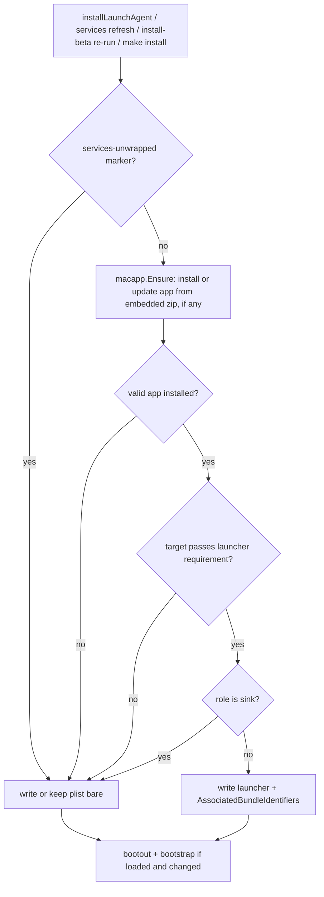

# macOS Login Items show agentcookie - Plan

## Goal Capsule

- Objective: On a Mac, agentcookie's background services, except the sink for now (R1), appear in System Settings > Login Items, and in the "background activity" notification, as "agentcookie" with an icon instead of the maintainer's personal name. This holds on new installs and on Macs that already run agentcookie, and no daemon stops working.
- Means: services start through a small signed launcher inside `agentcookie.app`, which execs the unchanged agentcookie binary. The app ships inside the darwin release binary (KTD1, KTD2).
- Authority: Requirements (R) win on product behavior. KTDs win on mechanism within the Rs. Units override neither.
- Stop conditions: stop and report before merging in any of these cases:
  - The live check in U8 still shows "Matthew Charles Van Horn" for a refreshed source or cmux-sync job.
  - A wrapped daemon loses Keychain access to Chrome Safe Storage, or needs a new grant to keep working.
  - Refresh leaves a job unloaded, or the launcher refuses a release-signed agentcookie.
  - A routine re-install re-posts the background-activity notification for every job.
- Execution profile: one PR. Go code, a Makefile target, shell installer changes and docs. Signing, notarizing and the live check run on the maintainer's Mac, which holds the Developer ID identity and the `agentcookie-notary` profile. CI has no signing identity, so signature checks sit behind injectable seams.
- Who finishes: the implementer lands U1 to U7 and runs U8 on this Mac before opening the PR. The first release that ships it is cut by the maintainer with `make release-pinned`.

---

## Product Contract

### Summary

Ship a minimal signed and notarized `agentcookie.app` that agentcookie installs into `~/Applications` on its own. Point the source and cmux-sync LaunchAgents at a launcher inside it and tag them with the app's bundle identifier. A new `agentcookie services refresh` rewrites existing plists in place, and the beta installer, the wizard and `make install` run it.

### Problem Frame

Since macOS 13, Background Task Management lists every launchd job in Login Items and notifies the user when one is added. A job whose program is a bare command-line binary has no app name or icon, so macOS falls back to the name on its code signature. agentcookie is signed "Developer ID Application: Matthew Charles Van Horn (NM8VT393AR)", so a new user sees "Software from 'Matthew Charles Van Horn' can run in the background" with a blank icon the first time a daemon starts. A person's name on a tool that reads browser cookies looks like spyware and costs trust. The maintainer saw it on their own Mac on 2026-11-04 (`sfltool dumpbtm` entries `8.dev.agentcookie.source` and `8.dev.agentcookie.cmux-sync`, parent identifier "Matthew Charles Van Horn"). Agent Tincan fixed the same problem for its services in its PR #144, and this plan ports that design.

### Requirements

Visible name

- R1. The `dev.agentcookie.source` and `dev.agentcookie.cmux-sync` LaunchAgents show as "agentcookie" with the agentcookie icon in Login Items and in the background-activity notification. The sink is the one exception until KTD8's evidence allows it.
- R2. A fresh install through `scripts/install-beta.sh` or `agentcookie wizard install` gets R1 with no admin password and no extra step.

Existing installs

- R3. A Mac that already runs agentcookie gets R1 after `agentcookie services refresh`, and the beta installer's re-run runs that refresh for the user.
- R4. A routine re-install does not replace an unchanged app and does not re-post the background-activity notification.

No regressions

- R5. Wrapped daemons keep their labels, arguments, logs, binary path, Keychain access and privacy grants. Linux output is unchanged.
- R6. A daemon never crash-loops because of the launcher. When the target binary would not pass the launcher's check, or the app can't be installed, the plist runs the binary directly as it does today.
- R7. The beta installer's healthy re-run still restarts in place and never sends a working sink back to pairing.
- R8. When R1 cannot take effect, `agentcookie doctor` says why and gives the fix, as a WARN, never a FAIL.
- R9. `agentcookie services refresh --revert` puts every service back to running agentcookie directly, and later installs keep it that way until `--wrap` is run.

Trust

- R10. The "agentcookie" name and icon only ever cover the release-signed agentcookie. The launcher refuses any other program.

### Scope Boundaries

- Linux and the sink's Linux path, the teammate installer, and the Chrome native-messaging pieces are unchanged.
- No change to the signing certificate, the Apple developer account name, or `scripts/sign.sh`'s signing identifier. The legacy per-binary Keychain ACLs are tied to identifier `agentcookie`.
- Known gap: a Mac running the sink keeps showing the signer's name for that one job until KTD8's evidence allows wrapping it.
- Not built: automatic `sfltool resetbtm`. It wipes every Login Item approval the user has, for all apps. The docs mention it as a manual last resort only.
- Not built: moving agentcookie itself into the app bundle. It would change the binary path the installer replaces and the code identity behind Keychain grants. It returns only if U8 shows the launcher approach fails.
- Not built: a self-heal on daemon start. A daemon whose launcher is missing never starts, so it can't repair itself. KTD4's bare rewrite on the next write and doctor's WARN cover that state, and U7's docs tell users not to delete the app.
- `.goreleaser.yaml`'s darwin build is stale, since releases build darwin with `make release-pinned`. It is left alone.

#### Deferred to Follow-Up Work

- A designed 1024px app icon. This plan ships a generated placeholder in the site palette (KTD7).
- Wrapping the sink on macOS, once a check on a Mac that runs the sink shows its Automation grant survives (KTD8). This Mac runs no sink, so U8 can't do it.

---

## Planning Contract

### Key Technical Decisions

- KTD1. Services launch through a launcher inside the app. `ProgramArguments` becomes `[<app>/Contents/MacOS/agentcookie-launcher, <agentcookie binary>, <role>, <args...>]`, and the plist carries `AssociatedBundleIdentifiers` = `dev.agentcookie.app`. The launcher resolves symlinks, verifies the target, then spawns the target as a child with `responsibility_spawnattrs_setdisclaim`, forwards launchd's signals and exits with the child's status. (Amended 2026-11-04 after U8: the first version exec'd the target, and the live check showed macOS then held agentcookie.app responsible for privacy checks, so both jobs lost access to Chrome's profile folder and stopped. A probe with a disclaiming launcher kept the access.)
  - (session-settled: user-approved — chosen over a new agentcookie-specific mechanism: port the launcher-app design Agent Tincan already verified on real Macs)
  - Why: Agent Tincan's research found the bundle-ID key alone has a mixed record. Jobs whose first program argument is inside an `.app` get the app's name. Tincan confirmed this by hand on two Macs.
  - Keychain: securityd identifies the caller by the running image's signature, and the child is the same signed agentcookie, so the partition list (`teamid:NM8VT393AR`) and the legacy `-T` ACLs match as before. U8 confirmed decryption still works through the disclaiming launcher.
  - Privacy (TCC): the child must disclaim responsibility. Without it, the app is the responsible code and agentcookie's own grants (Chrome profile folder) no longer apply.
  - Launcher requirement: `anchor apple generic and certificate 1[field.1.2.840.113635.100.6.2.6] exists and certificate leaf[field.1.2.840.113635.100.6.1.13] exists and certificate leaf[subject.OU] = "NM8VT393AR" and identifier "agentcookie"`. Matching the team ID alone isn't enough, since a self-signed certificate can set the same OU. `scripts/sign.sh` passes no `--identifier`, so codesign derives `agentcookie` from the file name, as `~/bin/agentcookie` and `~/go/bin/agentcookie` show today.
  - The launcher executable is named `agentcookie-launcher`, so `ps` and doctor's binary search never confuse it with agentcookie.
  - Rejected: `BundleProgram` and SMAppService. Both need the plist shipped inside the app bundle, which forces the binary into the bundle.
- KTD2. The signed, notarized and stapled app is embedded in the darwin agentcookie binary as a zip behind build tag `macapp`. agentcookie has no self-update, and the darwin tarball is the binary plus the installer, so embedding needs no new release asset. A build without the tag embeds nothing.
- KTD3. The app is identified as `dev.agentcookie.app`, named `agentcookie` (session-settled: user-approved — chosen over a capitalized "AgentCookie": the brand is lowercase everywhere), installed at `~/Applications/agentcookie.app`, and marked `LSUIElement` so it never shows a Dock icon. `Info.plist` declares no URL schemes, document types or services.
  - When it is replaced: only when the installed copy is missing, fails signature validation (team plus `dev.agentcookie.app`), or carries a lower integer `AppRevision` (stored as `CFBundleVersion`) than the embedded one. The revision is a constant bumped only when the launcher or bundle changes. A content-hash trigger would swap the app back and forth on a Mac with two release binaries.
  - How: extract to a temp directory next to the destination, validate it, swap it in atomically with `unix.RenamexNp` and `RENAME_SWAP` (`golang.org/x/sys` is already a dependency), remove the old copy, then run `lsregister -f` on the app.
- KTD4. One wrap decision, re-evaluated by every write. A plist is wrapped only when all of these hold. Otherwise it is written or rewritten bare.
  - The `services` marker file (KTD6) does not say reverted.
  - A valid app is installed, after this binary tries to install or update it from its embedded zip.
  - The target binary passes the launcher requirement.
  - The role isn't the sink (KTD8).

  The decision keys on the installed app, not on whether this binary embeds one. A `make install` build, which is signed but has no embedded app, still wraps when a release left a valid app behind. The next write unwraps a plist whose app or target signature is gone. Between an ad-hoc overwrite such as a plain `go install` and that next write, the launcher refuses the target and exits 0, so KeepAlive (`SuccessfulExit` false) leaves the job stopped instead of relaunching it every 10 seconds (R6). Doctor WARNs about that state and names `services refresh`.
- KTD5. Existing plists are edited in place with `/usr/bin/plutil`, never re-rendered. This keeps keys the installer or a user added. Only regular files named `dev.agentcookie.{source,sink,cmux-sync}.plist` whose `Label` equals the file stem are considered. Leftover `dev.agentcookie.oneshot.*` files and `*.bak` copies are skipped.
  - A plist is changed only when its program is an agentcookie binary, or a launcher at the known app path followed by one. Anything else is reported and skipped.
  - Edits are atomic: modify a temp copy, run `plutil -lint`, then rename it over the original.
  - Loaded jobs are restarted with `launchctl bootout` and then `bootstrap`, since `kickstart` doesn't reread the plist. Refresh waits until `launchctl print` no longer finds the job, and retries a bounded number of times. On final failure it restores the original plist, reloads it, and reports loudly.
  - Refresh never restarts the job it runs under, which it finds from `XPC_SERVICE_NAME`. That plist is rewritten and reported as "takes effect at next restart".
  - New installs still go through `launchd.Spec.Render`, which gains an optional launcher. With no launcher, its output is byte-identical to today's.
- KTD6. Revert persists. `services refresh --revert` unwraps everything and writes `~/.agentcookie/services-unwrapped`. Every later write, including the installer's refresh, the wizard and `cmux-sync enable`, honors it. `services refresh --wrap` removes it and wraps again.
- KTD7. (session-settled: user-approved — chosen over waiting for designed art: no icon exists in the repo) Placeholder icon: a 1024px PNG committed at `assets/macapp/icon-1024.png`, drawn in the site palette from `web/app/opengraph-image.tsx` (ink pink `#E5006D` on paper cream `#F4EFE6`). The `mac-app` target scales it into an `.icns` with `sips` and `iconutil`. A designed icon later replaces the PNG and bumps `AppRevision`, so existing installs pick it up under KTD3.
- KTD8. The sink stays bare by default. The sink quits Chrome through `osascript` (`internal/chromectl/chromectl.go`), which needs an Automation grant. With an app-embedded program and `AssociatedBundleIdentifiers`, macOS may credit that grant to `dev.agentcookie.app` instead. That would quietly stop Chrome from quitting before the cookie write. The sink joins the launcher only once a live check shows the grant still applies. A refresh unwraps a sink that something else wrapped.
- KTD9. Login-items findings never FAIL. `scripts/install-beta.sh` treats any doctor FAIL on a re-run as "run the wizard", which asks a sink for a pair code. So the installer runs `services refresh` before doctor, and doctor reports login-items problems as WARN.

### High-Level Technical Design

How a service starts after the change:

```mermaid
sequenceDiagram
  participant L as launchd (gui/uid)
  participant A as agentcookie.app launcher
  participant T as agentcookie binary
  L->>A: start dev.agentcookie.source (ProgramArguments[0] inside the app)
  Note over L,A: BTM attributes the job to the app, name and icon
  A->>A: resolve symlinks, check Developer ID + identifier "agentcookie"
  A->>T: posix_spawn(argv[1], argv[1:]) with responsibility disclaimed; wait, forward signals
  T-->>L: runs as today, same args, logs, Keychain identity
```

The wrap decision every write path runs (KTD4):



### Assumptions

- Login Items attribution comes from the plist's first program argument and the bundle-ID key, not from the running process, so running the binary as a child doesn't undo R1. Tincan observed this, and U8 confirms it here.
- `/usr/bin/plutil`, `lsregister`, `sips`, `iconutil`, `ditto` and `codesign` exist on every supported macOS.

---

## Implementation Units

### U1. Launcher, app bundle and `mac-app` build

- Goal: produce a signed, notarized, stapled `agentcookie.app` zip ready to embed.
- Requirements: R1, R2, R10.
- Dependencies: none.
- Files:
  - `cmd/agentcookie-launcher/main.go`, `cmd/agentcookie-launcher/main_test.go`
  - `internal/macapp/Info.plist.tmpl`
  - `assets/macapp/icon-1024.png`
  - `Makefile`, `.gitignore`
- Approach:
  1. The launcher execs `argv[1]` with `argv[1:]` after the KTD1 checks: the path is absolute, resolves to a regular executable file, and passes the requirement through an injectable verifier backed by `/usr/bin/codesign --verify --strict -R`. On any refusal it prints one stderr line and exits 0, so launchd's KeepAlive doesn't relaunch it (KTD4). Run with no arguments, as from Finder, it exits 0. It imports only `internal/macapp`, which stays a leaf package with no cgo, so it builds with `CGO_ENABLED=0`.
  2. A `mac-app` make target builds the launcher for arm64 and amd64 and joins them with `lipo`. It assembles the bundle with `Info.plist` (KTD3 identifiers, `CFBundleVersion` = `AppRevision`, `LSUIElement`) and an `.icns` built per KTD7.
  3. It signs the inner executable, then the bundle, with `--options runtime --timestamp`, no entitlements and no `--deep`, inline rather than through `scripts/sign.sh`, whose apple-events entitlement check would reject the launcher. It uses `AGENTCOOKIE_SIGN_IDENTITY`. It then notarizes a `ditto` zip with `AGENTCOOKIE_NOTARY_PROFILE`, staples the app, and re-zips the stapled app with `ditto --norsrc --noextattr` to `internal/macapp/embedded/agentcookie.zip`, which is gitignored.
  4. `release` runs `mac-app` first and builds both `build-universal` slices with `-tags macapp`. It fails when the zip is missing.
- Patterns to follow: Agent Tincan's `cmd/agent-tincan-app/main.go` and its `mac-app` recipe. In agentcookie, follow the existing `build-universal`, `sign` and `notarize` targets.
- Test scenarios:
  - Launcher with `[/abs/fake, a, b]` and an accepting verifier execs the fake with exactly `a b`. The test injects the exec function and asserts the path and argv.
  - A relative path, a missing file, a directory or a non-executable file exits 0 without exec and names the problem on stderr.
  - A rejecting verifier exits 0 without exec and prints a signature message.
  - A symlinked target is verified and exec'd at its resolved path.
  - No arguments exits 0 without exec.
  - The production requirement string contains the Apple anchor, both Developer ID certificate fields, `NM8VT393AR` and `identifier "agentcookie"`.
- Verification: on this Mac, `codesign --verify --strict --deep` passes on the built app, `spctl -a -t exec -vv` reports Notarized Developer ID, and `stapler validate` succeeds.

### U2. Embed, install and validate the app

- Goal: agentcookie can install or update `~/Applications/agentcookie.app` from its embedded zip, and can tell whether a valid app is installed.
- Requirements: R2, R4, R6.
- Dependencies: U1.
- Files:
  - `internal/macapp/macapp.go`, `internal/macapp/macapp_test.go`
  - `internal/macapp/embed_macapp.go` (build tag `macapp`), `internal/macapp/embed_none.go`
  - `internal/macapp/swap_darwin.go`, `internal/macapp/swap_other.go`
- Approach:
  1. `Ensure(home)` installs or updates the app per KTD3 and returns the launcher path. It returns a typed unavailable result on non-darwin, and when no valid app is installed and this binary embeds none.
  2. `LauncherFor(target)` answers KTD4's last two checks, a valid installed app and a target passing the requirement, through the same injectable validator and verifier.
  3. `Remove(home)` deletes the app for uninstall.
- Patterns to follow: tincan's `internal/macapp/macapp.go` and its swap files. Seams follow agentcookie's package-var style (`codesignRunner` in `internal/chrome/keychain.go`).
- Test scenarios:
  - Fresh home with an injected test zip: the app appears at the KTD3 path with an executable launcher, and the returned path is that launcher.
  - A valid app with the same revision is already installed: nothing is rewritten, and its mtime is unchanged.
  - The installed app has a lower revision: it is replaced, and no temp directory is left behind.
  - The installed app has a higher revision than the embedded one: it is kept.
  - The installed app fails validation: it is replaced.
  - Corrupt zip or wrong bundle identifier: an error, and any existing app is left intact.
  - No embedded zip and no installed app: unavailable, and nothing is written.
  - No embedded zip but a valid app installed: the installed launcher path is returned, which is the `make install` case.
- Verification: the tests pass on Linux and macOS CI. A locally built `-tags macapp` binary installs a launchable app.

### U3. New plists use the wrap decision

- Goal: every plist agentcookie writes goes through KTD4, including the one-shot Keychain helper.
- Requirements: R1, R2, R5, R6, R10.
- Dependencies: U2.
- Files:
  - `internal/launchd/plist.go`, `internal/launchd/plist_test.go`
  - `internal/launchd/wrap.go`, `internal/launchd/wrap_test.go`
  - `internal/cli/wizard.go` (`installLaunchAgent`, `runWizardUninstall`)
  - `internal/chrome/launchagent_helper.go`, `internal/chrome/launchagent_helper_test.go`
- Approach:
  1. `launchd.Spec` gains an optional `Launcher`. `Render` puts it before `BinaryPath` and adds an `AssociatedBundleIdentifiers` block. It now XML-escapes every interpolated path.
  2. A single wrap-decision function implements KTD4, including the marker from KTD6 and the sink rule from KTD8. `installLaunchAgent` calls it before `launchd.Install`, so the source, sink and cmux-sync paths all pick it up.
  3. The one-shot helper takes the launcher when the decision allows it. It gets no bundle-ID key, since it is transient.
  4. `wizard uninstall` removes the app when no `dev.agentcookie.{source,sink,cmux-sync}` plist remains.
- Patterns to follow: `internal/launchd/plist_test.go` render assertions. The `cmuxSyncInstallAgent` seam in `internal/cli/cmux_sync_enable.go`.
- Test scenarios:
  - A spec with no launcher renders byte-identical XML to today's for each role.
  - A spec with a launcher renders it first in `ProgramArguments`, then the binary, role and args, plus `AssociatedBundleIdentifiers` = `dev.agentcookie.app`. The output parses as a plist.
  - A binary path containing `&` or `<` renders as valid XML.
  - The decision returns bare for each failing input: marker present, no valid app, target rejected, role sink. It returns the launcher only when all pass.
  - The one-shot plist carries the launcher when allowed, and is unchanged when not.
- Verification: `go test ./internal/launchd/... ./internal/chrome/... ./internal/cli/...` passes on Linux and macOS.

### U4. `agentcookie services refresh`

- Goal: rewrite existing plists in place to match the wrap decision, and run that refresh from the wizard and `cmux-sync enable`.
- Requirements: R3, R4, R5, R6, R9.
- Dependencies: U3.
- Files:
  - `internal/cli/services.go`, `internal/cli/services_test.go`
  - `internal/cli/root.go`
  - `internal/cli/cmux_sync_enable.go`, `internal/cli/wizard.go`
- Approach:
  1. `services refresh` applies KTD5 to each candidate plist, wrapping or unwrapping per KTD4, and prints one line per job: wrapped, unwrapped, unchanged, skipped and why, or takes effect at next restart.
  2. `--revert` and `--wrap` implement KTD6.
  3. plutil and launchctl sit behind one ops seam, so tests run without either. Tests that use the real plutil skip on non-darwin.
  4. The wizard's source and sink installs and `cmux-sync enable` finish by refreshing the other agentcookie plists, so a re-run fixes jobs it didn't rewrite.
- Patterns to follow: tincan's refresher in `internal/cli/services.go`, cut down to agentcookie's three labels. Cobra registration in `internal/cli/root.go`. The `skipUnlessDarwin` helper in `internal/cli/sink_test.go`.
- Test scenarios:
  - A bare source plist with an extra key a user added: wrapped, the extra key is kept, and the job is restarted.
  - An already-wrapped plist: unchanged, no restart.
  - A wrapped plist whose target now fails the requirement: unwrapped and restarted.
  - A wrapped sink plist: unwrapped.
  - `dev.agentcookie.source.plist.bak`, `dev.agentcookie.oneshot.1a2b3c4d.plist`, a symlinked plist, a Label that doesn't match the file stem, and a program that isn't agentcookie: each is skipped with a reason.
  - A job that isn't loaded: rewritten, not bootstrapped.
  - Bootstrap fails on every retry: the original plist is restored and reloaded, and the command exits non-zero.
  - `XPC_SERVICE_NAME` equals the job's label: rewritten, not restarted, and reported as next restart.
  - `--revert` unwraps everything and writes the marker. A later plain refresh leaves them bare. `--wrap` removes the marker and wraps.
  - Integration: on macOS CI, a real plutil edit of a fixture plist lints clean and round-trips every original key.
- Verification: the tests pass on macOS CI. On this Mac, U8.

### U5. Doctor understands the launcher

- Goal: doctor reads wrapped plists correctly and explains any job that isn't showing as agentcookie.
- Requirements: R8.
- Dependencies: U3, U4.
- Files:
  - `internal/cli/doctor.go`, `internal/cli/doctor_test.go`
- Approach:
  1. `extractLaunchAgentBinaryPath` returns the agentcookie target, skipping a launcher at index 0 that sits inside the known app path.
  2. A darwin-only "Login Items" check WARNs, never FAILs (KTD9), on each of these, with the fix:
     - no valid app installed
     - a source or cmux-sync plist that is bare while the decision would wrap it, fixed by `services refresh`
     - the revert marker present
     - a wrapped plist whose target fails the requirement
  3. The sink's bare state is reported as INFO with the KTD8 reason.
- Patterns to follow: the injected-probe shape of `checkBinarySignatureWith` and `checkCmuxLocalLoopWith`. `HOME` set to a temp dir as in `doctor_test.go`.
- Test scenarios:
  - A wrapped plist: the daemon binary path check compares the target at index 1, and passes when that is this binary.
  - A bare plist: the path check behaves as today.
  - Each Login Items state above produces a WARN naming its fix. A fully wrapped install produces OK.
  - A wrapped plist whose target fails the requirement WARNs and names `services refresh`.
  - On Linux, the check is absent.
- Verification: the tests pass. On this Mac, doctor shows OK after U8's refresh.

### U6. Installer and `make install` refresh

- Goal: the beta installer's re-run and `make install` bring existing Macs to R1 without breaking R7.
- Requirements: R3, R7.
- Dependencies: U4.
- Files:
  - `scripts/install-beta.sh`
  - `scripts/release_asset_test.sh`
  - `Makefile` (`install` target)
- Approach:
  1. `plist_program_path` returns the agentcookie target when `ProgramArguments[0]` is the launcher inside `agentcookie.app`, and both program checks in `restart_healthy_install`, the plist one and the `launchctl print` one, accept `[launcher, $TARGET]`.
  2. On a darwin re-run, the installer runs `"$TARGET" services refresh` before doctor (KTD9). Refresh does the restart, and `kickstart -k` remains for jobs it reports unchanged.
  3. `make install` runs the freshly signed binary's `services refresh` after `scripts/sign.sh`.
- Patterns to follow: the existing `write_plist` and stub launchctl fixtures in `scripts/release_asset_test.sh`.
- Test scenarios:
  - `plist_program_path` on a bare plist returns the binary, and on a wrapped plist returns the binary at index 1.
  - `restart_healthy_install` with a wrapped plist and a stub `launchctl print` whose `program =` is the launcher succeeds without the wizard.
  - A wrapped plist pointing at a different binary still fails the check, as a bare one does today.
  - The installer calls refresh before doctor on a darwin re-run. A stub binary records its call order.
- Verification: `bash scripts/release_asset_test.sh` passes on Linux and macOS CI.

### U7. Docs and changelog

- Goal: operators and the release process know about the app, refresh and revert.
- Requirements: R3, R8, R9.
- Dependencies: U1, U4, U5.
- Files:
  - `README.md`, `docs/quickstart.md`
  - `docs/releasing.md`, `docs/runbook-v0.12-codesign.md`
  - `CHANGELOG.md`
- Approach:
  1. Add a short Login Items section saying what the app is, that it holds only a launcher and must not be deleted while services use it, and how to use `services refresh`, `--revert` and `--wrap`. It also covers the sink exception, and `sfltool resetbtm` as a last resort that resets every app's approvals.
  2. In the release docs, note that `make release` now builds, signs, notarizes and staples the app first, with the same identity and notary profile.
  3. The changelog tells current Mac users to re-run the installer or run `agentcookie services refresh` once.
- Test expectation: none, docs only.
- Verification: the docs name only commands that exist after U4.

### U8. Live check on this Mac

- Goal: show R1 on a real Mac and check the stop conditions before opening the PR.
- Requirements: R1, R3, R4, R5, R6.
- Dependencies: U1 to U6.
- Files: none.
- Execution note: this is packaging and OS behavior, so prove it with runtime checks, not unit tests. It restarts the two live agentcookie jobs on this Mac. It doesn't touch cmux itself.
- Approach:
  1. Build the app with `make mac-app`, then a `-tags macapp` agentcookie, sign it, and install it over `~/go/bin/agentcookie`, the path the live plists use.
  2. Run `agentcookie services refresh`. Check with `sfltool dumpbtm` that `8.dev.agentcookie.source` and `8.dev.agentcookie.cmux-sync` now show Name "agentcookie" with the `dev.agentcookie.app` parent, and check System Settings > Login Items. If the name shows as the launcher's executable name, rename the executable to match the app (Agent Tincan's executable shares its app's name).
  3. Check that both jobs are running, that source still reads Chrome Safe Storage with no prompt, and that cmux-sync still injects.
  4. Run `agentcookie doctor` and check the Login Items line.
  5. Run refresh again. Nothing changes and no new notification appears.
  6. Run `--revert`, check the bare plists and the marker, then `--wrap` again.
  7. Replace the target with an ad-hoc build and restart the job without refreshing. Check that `launchctl print` shows it stopped, not respawning, and that doctor WARNs. Then refresh, and check that it unwraps and runs. Then restore the signed build.
- Verification: each step's result is recorded in the PR's Verification section, including anything that didn't match.

---

## Verification Contract

| Gate | Command | Applies to |
|---|---|---|
| Vet | `go vet ./...` | all units |
| Unit tests | `go test -race ./...` on macOS, `go test ./...` on Linux | U1 to U6 |
| Tagged build | `go build -tags macapp ./...` with a stub zip in `internal/macapp/embedded/` | U2 |
| Shell tests | `bash scripts/release_asset_test.sh` | U6 |
| Lint | `golangci-lint run`, as in `.github/workflows/lint.yml` | all Go units |
| App signature | `codesign --verify --strict --deep`, `spctl -a -t exec -vv`, `stapler validate` on the built app | U1, U8 |
| Live | U8 steps on this Mac | U8 |

## Definition of Done

- Every Requirement is met or, for the sink, recorded as the known gap in Scope Boundaries.
- All Verification Contract gates pass, and CI is green on the PR.
- U8's results, including any mismatch, are in the PR description.
- No stop condition fired, or the PR reports it and does not merge.
- No dead-end or experimental code from abandoned approaches remains in the diff.

---

## Deferred / Open Questions

### From 2026-11-04 review

- Applied during work: a first install uses a plain rename; `RENAME_SWAP` is used only when replacing an installed app, as Agent Tincan's `internal/macapp` does.

### From 2026-11-04 live check (U8)

- The exec launcher broke both jobs on this Mac: `watch .../Chrome/Default: operation not permitted`, exit 1. Probe jobs running `agentcookie doctor` showed launcher plus bundle-ID key and launcher alone both lost Chrome profile access, while the bundle-ID key alone and the bare job kept it. A probe through a launcher that spawns with `responsibility_spawnattrs_setdisclaim` kept Chrome and Keychain access. KTD1 now uses that.
- Login Items did not re-read the edited plists live: `sfltool dumpbtm` kept the old executable path after the refresh, and probe jobs bootstrapped from a terminal were never registered. The "agentcookie" name is confirmed only after macOS re-registers the jobs, at the latest after the next login.
- `make install` cannot overwrite a universal release binary (`go install` refuses a file that "is not an object file"). Pre-existing; U8 used `make build MACAPP=1`, `scripts/sign.sh` and a copy instead.

---

## Sources

- Agent Tincan's plan for the same fix, `docs/plans/2026-10-08-1342-fix-macos-login-items-name-plan.md` in `mvanhorn/agent-tincan`, and its code: `cmd/agent-tincan-app/main.go`, `internal/macapp/`, `internal/cli/services.go`, and the `mac-app` recipe in its `Makefile`.
- Plist touch points: `internal/launchd/plist.go`, `internal/cli/wizard.go` (`installLaunchAgent`), `internal/cli/doctor.go` (`extractLaunchAgentBinaryPath`, `checkDaemonBinaryPath`), `scripts/install-beta.sh` (`plist_program_path`, `restart_healthy_install`).
- Keychain identity: `internal/chrome/keychain.go` (`TeamPartitionList`), `internal/cli/wizard_keychain.go`, `docs/runbook-v0.12-codesign.md`.
- Sink Automation grant: `internal/chromectl/chromectl.go`, `scripts/agentcookie.entitlements`.
