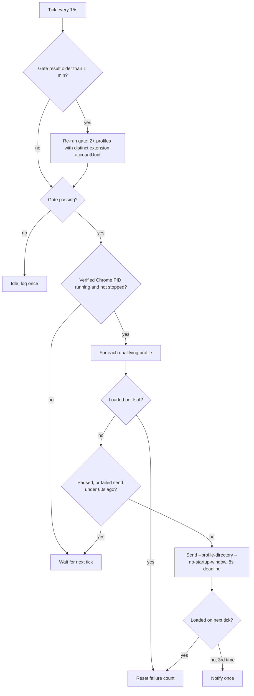

# Chrome Profile Keep-Alive for Claude in Chrome - Plan

## Goal Capsule

- Objective: On a Mac where each Claude account has its own Chrome profile with Claude in Chrome signed in, every Claude Code session finds a connected browser for its current account, through reboots, crashes, closed windows, and ccswap account switches, without the user doing anything and without anything taking over the screen. Everyone else sees no change.
- Means: a new `agentcookie profile-keepalive` LaunchAgent role that loads each qualifying profile windowless in the already-running Chrome (KTD1, KTD2), gated on two or more profiles signed into different Claude accounts (KTD3).
- Authority: this plan's Requirements win on behavior. KTDs win on mechanism. The repo's own conventions (cobra commands, `internal/launchd` roles, doctor severities, build tags) win on style.
- Stop conditions: stop and report if U1's spike shows that windowless loading does not bring up the extension's native host. Do not fall back to opening windows without the owner's OK (R4).
- Execution profile: one PR to mvanhorn/agentcookie, macOS behavior, Linux must still build and test.
- Who finishes: `ce-work` builds, verifies on the owner's Mac, opens the PR, and installs the job for the owner once merged.

---

## Product Contract

### Summary

Add a small background job to agentcookie that keeps every Chrome profile paired with a distinct Claude account loaded. It loads a missing profile inside the running Chrome with no window, so the Claude in Chrome extension in that profile stays connected. It does nothing unless the machine actually has two or more such profiles.

### Problem Frame

Claude in Chrome pairs only with the Claude account its extension is signed into. The owner runs two Claude Code accounts, and ccswap switches between them when one nears its limit. Earlier today they set up one Chrome profile per Claude account (Default and Profile 1) and copied logins across with `agentcookie profile-sync` (#158). That works only while both profiles are loaded. Chrome unloads a profile when its last window closes, and at launch it restores only the last-active profile. So after a reboot, a crash, or closing Profile 1's window, Claude in Chrome silently stops working for that account. Tonight this session was on the esperlabs account, Profile 1 was not loaded, and the connected-browser list was empty.

### Requirements

Gating
- R1. The keep-alive acts only when two or more Chrome profiles have Claude in Chrome installed and signed into different Claude accounts. On any other machine it installs nothing, starts nothing, and logs at most one line saying why. When the gate passes, a qualifying profile is every profile whose extension is signed into any account, including a second profile on an account already present.
- R2. The running job re-checks R1 at most once a minute and goes idle, without error or restart loops, when the condition stops holding.

Keeping profiles connected
- R3. Whenever Chrome is running, every qualifying profile is loaded within about 30 seconds of being unloaded, except while it is paused (R6) or Chrome is not responding (R5).
- R4. Loading a profile never opens a window, never takes focus, and never moves the cursor.
- R5. The job never quits, restarts, or launches Chrome, never leaves a second Chrome running, and never acts on a Chrome that is not responding. If Chrome is not running, the job waits.
- R6. The owner can pause the keep-alive for one profile for a set time, and `profile-sync` tells them to do this before it runs, so the keep-alive never reopens a profile that `profile-sync` needs closed.

Visibility and control
- R7. When three load commands in a row for one profile leave it unloaded, the job sends one macOS notification naming the profile, then stays quiet until that profile recovers. Skipped cycles neither count nor reset the count.
- R8. `agentcookie doctor` reports the keep-alive's state as OK, Warn, or Skipped, never FAIL.
- R9. The owner can turn it off with one command. Turning it off removes the LaunchAgent and stays off: a later `wizard install` does not turn it back on.
- R10. The docs and the enable message say that while the keep-alive is on, closing a profile's windows no longer cuts Claude in Chrome's access to that profile. Only turning it off does.

### Acceptance Examples

- AE1. Covers R1. Given a machine with one Chrome profile, or two profiles whose extensions are signed into the same Claude account, when `wizard install` or `profile-keepalive enable` runs, then no LaunchAgent is written and the output says the keep-alive is not needed.
- AE2. Covers R3, R4. Given Default and Profile 1 qualify and the owner closes Profile 1's last window, when 30 seconds pass, then Profile 1 is loaded again, a second `claude --chrome-native-host` process exists, no Chrome window appeared, and the frontmost app did not change.
- AE3. Covers R5. Given the owner quits Chrome, when the job's next cycle runs, then it does not launch Chrome. When the owner reopens Chrome, both profiles are loaded within 30 seconds.

### Scope Boundaries

- Not changing the Claude in Chrome extension's one-account limit or adding a background permission to it. Only Anthropic can do that.
- Not changing ccswap. Each profile stays paired with its own account, so a switch needs no signal.
- Not copying Google logins between profiles. Google ties them to the profile.
- Considered and not built: launching Chrome when the owner has quit it. Running an invisible Chrome the owner just quit would surprise them. Revisit if the owner asks for it.
- Considered and not built: a separate `status` subcommand. `doctor` already reports the state (R8). Revisit if the owner wants per-profile detail outside doctor.
- Considered and not built: opening a minimized window as a fallback. Every window-opening route can take focus, per research. Revisit only with the owner's OK if U1 fails.

### Deferred to Follow-Up Work

- Linux support. The job is macOS-only for now and builds as a no-op elsewhere.

---

## Planning Contract

### Key Technical Decisions

- KTD1. Load profiles windowless by running the Chrome binary directly with `--profile-directory=<dir> --no-startup-window`. The running Chrome receives the arguments and loads the profile without a window. Chromium source supports this. It is untested here, so U1 proves it first. `open -a ... --args` is not used because it drops arguments for a running Chrome, and `open -g` with a new window can still take focus.
- KTD2. Detect "loaded" with `lsof` on the real Chrome PID, counting open files under each profile directory. Find the PID by reading the `SingletonLock` symlink in the Chrome user data dir, not by process name, because headless automation Chrome instances on this machine share the binary name. Accept that PID only when the lock's hostname matches this Mac and the PID's executable is the Chrome binary the loader will run. After a crash the lock can be left behind with a PID that now belongs to another process, and treating that as "Chrome running" would make the loader start a new hidden Chrome. Local State `last_active_profiles` is not used because it lags reality.
- KTD3. Gate on the `accountUuid` the extension itself stores, read from each profile's `Local Extension Settings/fcoeoabgfenejglbffodgkkbkcdhcgfn` LevelDB. Copy the directory to a temp dir before opening it, since Chrome holds the LevelDB lock. Use `github.com/syndtr/goleveldb` for reading, because `.ldb` tables can be compressed and a raw byte scan would miss them. The claude.ai browser cookie is not used because it can differ from the account the extension is paired with, and reading it needs Keychain access.
- KTD4. Run each send with an 8-second deadline and kill the sender, never Chrome, if it has not exited by then. A sender to a healthy Chrome hands off and exits within a second or two. A sender to a hung Chrome waits about 20 seconds and then kills that Chrome, which would lose the owner's live sessions (R5). Killing the sender first means that kill never happens. The same deadline catches a sender that became a new browser because Chrome quit between the check and the send (R5). A timed-out send counts as a failed load (R7). Before sending, also skip when the Chrome PID's `ps` state is stopped (`T`) or uninterruptible (`U`/`D`). After a send that leaves the profile unloaded, wait 60 seconds before sending again. A profile that unloads after a load that worked is reloaded on the next cycle. An AppleScript probe was rejected because it needs Automation permission and can raise a prompt.
- KTD5. Run as a new launchd role `profile-keepalive` that loops internally every 15 seconds. This fits the existing always-running plist template instead of adding a timer option to it.
- KTD6. Follow the `cmux-sync` enable model: `enable` is a no-op that exits 0 when the gate fails, `wizard install` calls a non-fatal maybe-enable at the end, and `--no-profile-keepalive` opts out. `disable` writes an opted-out marker under `~/.agentcookie/profile-keepalive/`, and the wizard's maybe-enable skips when that marker exists (R9). Only an explicit `enable` clears it.
- KTD7. Pausing writes a marker file with an expiry under `~/.agentcookie/profile-keepalive/`, and the loop skips any profile with an unexpired marker. The loop never touches `profile-sync`'s own lock file, because `profile-sync` takes that lock without waiting and would fail if the keep-alive held it even briefly.

### High-Level Technical Design

One cycle of the job:

### Risks

- A Claude in Chrome update could rename or move `accountUuid`. Then the gate fails closed: the job idles and doctor reports Warn with the reason, so nothing acts on a machine it cannot verify.
- A Chrome update could change how a running Chrome treats `--no-startup-window`. Then loads stop working, and R7's notification and doctor's Warn surface it.
- A hung Chrome that `ps` reports as running still gets a send, but KTD4's deadline kills the sender before it can kill Chrome. If U1 shows a healthy handoff takes longer than a few seconds, the deadline must be retuned to stay well under Chrome's 20 seconds.
- The gate copies each profile's extension storage, which may hold Claude login data, so U2 keeps those copies private and short-lived.

### Assumptions

- Re-sending the load command to an already-loaded profile is harmless. Research says it is. U1 confirms it.
- The gate's account read runs at most once a minute, so copying two small LevelDB folders costs little.

---

## Implementation Units

### U1. Prove windowless loading on the owner's Mac

- Goal: Confirm KTD1 before building on it.
- Requirements: R3, R4
- Dependencies: none
- Files: none committed. Record the findings in the PR description.
- Approach:
  1. With Profile 1 unloaded (zero `lsof` files under its folder), run the Chrome binary with the two flags.
  2. Check that no window appeared, that the frontmost app did not change, that Profile 1 files show up in `lsof`, and that a new `claude --chrome-native-host` child appears.
  3. Check from a Claude Code session on that profile's account that the connected-browser list includes it.
  4. Re-send once and confirm nothing changes.
  5. Five minutes later, with nothing done in that profile, confirm it is still loaded, its native host is still running, and the connected-browser list still includes it.
  6. Record how long the sender process takes to exit, which sets KTD4's deadline.
- Execution note: This is a runtime spike. If step 2, 3, or 5 fails, stop per the Goal Capsule.
- Test expectation: none -- manual spike that gates the rest.
- Verification: All six checks pass and are written up.

### U2. Profile discovery and the account gate

- Goal: List profiles that have the extension and return the Claude account each one is paired with.
- Requirements: R1, R2
- Dependencies: U1
- Files: `internal/chrome/claudeext.go`, `internal/chrome/claudeext_test.go`, `go.mod`, `go.sum`
- Approach: Enumerate profile dirs with the existing `internal/chromepaths` discovery, check for the extension folder, copy its LevelDB to a temp dir, and read `accountUuid` (KTD3). Make the copy in a fresh 0700 temp dir with an agentcookie prefix and delete it as soon as the read ends, success or failure. On startup, delete any leftover prefixed dirs from a killed run. Return the qualifying set (R1) only when it has two or more distinct accounts.
- Patterns to follow: `internal/chromepaths/discover.go`, the closed-read approach in `internal/chrome/read.go`.
- Test scenarios:
  - Two profile fixtures with different `accountUuid` values qualify both.
  - Two fixtures with the same `accountUuid` qualify none.
  - One profile with the extension and one without qualifies none.
  - A profile whose extension storage has no `accountUuid` (signed out) is excluded without error.
  - A corrupt or locked LevelDB folder is excluded and the error is returned for logging, not raised.
  - Three profiles on two accounts, two of them sharing one account, qualify all three.
  - No temp copy remains after a successful read, after a failed read, or after startup cleanup finds a leftover.
- Verification: The tests pass. Against the owner's real profiles it reports Default and Profile 1 with different accounts.
- Test seam: fixture LevelDB folders built in `t.TempDir()`. This catches parsing and gating, not the extension later changing its storage key.

### U3. Load detection and the windowless loader

- Goal: Tell whether a profile is loaded and load it safely.
- Requirements: R3, R4, R5
- Dependencies: U1
- Files: `internal/chromectl/profileload_darwin.go`, `internal/chromectl/profileload_other.go`, `internal/chromectl/profileload_test.go`
- Approach: Resolve and verify the real PID from `SingletonLock` (KTD2), count `lsof` entries per profile dir, skip on a stopped state, then run the binary with the KTD1 flags under the KTD4 deadline. Command execution is injected so tests never touch Chrome.
- Patterns to follow: `internal/chromectl` existing `IsRunning`, the `lsof` use in `internal/cli/profile_sync.go`.
- Test scenarios:
  - `lsof` output with files under `Profile 1/` reports it loaded.
  - `lsof` output with only Default files reports Profile 1 unloaded.
  - A missing `SingletonLock` reports Chrome not running and the loader does nothing.
  - A stale `SingletonLock` pointing at a dead PID reports not running.
  - A stale `SingletonLock` pointing at a live non-Chrome PID reports not running, and the loader does nothing.
  - A `SingletonLock` with another machine's hostname reports not running.
  - A process in a stopped state fails the guard and the loader does nothing.
  - The loader builds exactly the binary path plus the two flags, never `open -a`.
  - A fake sender that exits at once reports a completed send.
  - A fake sender that never exits is killed at the deadline, only the sender is signalled, and the result is a failed load.
- Verification: Tests pass on macOS and the Linux build compiles the no-op file.

### U4. The keep-alive command and loop

- Goal: Wire the cycle in the design diagram into `agentcookie profile-keepalive run`, with `enable`, `disable`, and `pause`.
- Requirements: R1, R2, R3, R6, R7, R9, R10
- Dependencies: U2, U3
- Files: `internal/cli/profile_keepalive.go`, `internal/cli/profile_keepalive_test.go`, `internal/cli/profile_sync.go`, `internal/cli/root.go`
- Approach:
  1. `run` loops every 15 seconds (KTD5), re-runs the gate at most once a minute (R2), and skips paused profiles (KTD7).
  2. It keeps a per-profile failure count under R7's counting rule and calls the injected notifier once at three, resetting when the profile recovers.
  3. `enable` checks the gate, clears the opted-out marker, installs the LaunchAgent only when the gate passes (KTD6), and prints the R10 line. `disable` removes the agent and writes the opted-out marker.
  4. `pause --profile <dir> --for <duration>` writes the KTD7 marker. `profile-sync`'s "profile is open in Chrome" error names this command.
- Patterns to follow: `internal/cli/cmux_sync_enable.go`, the state-file writer `saveProfileSyncState` in `internal/cli/profile_sync.go`, `ownerNoticeFunc = notify.Show` in `internal/cli/teammates_lifecycle.go`.
- Test scenarios:
  - Covers AE1. The gate fails, `enable` writes no plist and exits 0 with a "not needed" message.
  - Covers AE2. A fake detector reports Profile 1 unloaded, the loader is called once, and on the next tick it reports loaded.
  - Covers AE3. Chrome is not running, so the loader is never called, and when it starts running the loader is called.
  - Profile 1 is paused for 10 minutes, so it is not reloaded during that time, other profiles still are, and it is reloaded after the marker expires.
  - The loop never opens `profile-sync`'s lock file.
  - Three failed loads in a row produce exactly one notification, a fourth produces none, and recovery followed by three more failures produces one more.
  - A paused or skipped cycle between two failed loads neither adds to nor resets the count.
  - After a failed send, no new send happens for 60 seconds. After a load that worked and a later unload, the next cycle sends at once.
  - The gate flips to failing mid-run, so the loop goes idle and makes no further loader calls.
  - `disable` followed by the wizard's maybe-enable installs nothing. `enable` after that installs the agent.
- Verification: Tests pass. On the owner's Mac, `doctor` shows the keep-alive OK with both profiles loaded.

### U5. LaunchAgent role, wizard, and doctor

- Goal: Install and report the job like the other agentcookie background jobs.
- Requirements: R1, R8, R9
- Dependencies: U4
- Files: `internal/launchd/plist.go`, `internal/launchd/plist_test.go`, `internal/cli/macapp_uninstall.go`, `internal/cli/wizard.go`, `internal/cli/doctor.go`, `internal/cli/doctor_test.go`
- Approach: Add the `profile-keepalive` role everywhere the repo lists roles (constant, `Render` check, `managedRoles`), install through `installLaunchAgent`, add a non-fatal maybe-enable at the end of `wizard install` with a `--no-profile-keepalive` opt-out, and add a doctor check.
- Patterns to follow: `maybeAutoEnableCmux()` in `internal/cli/wizard.go`, `checkCmuxLocalLoopWith` in `internal/cli/doctor.go`.
- Test scenarios:
  - The plist renders for the new role with the expected label and arguments.
  - Doctor reports Skipped when the gate fails, when the owner turned the keep-alive off, or when Chrome is not running. It reports OK when the agent is installed and every qualifying profile is loaded, and Warn when Chrome is running and a qualifying profile is unloaded, or the agent is missing. It never reports FAIL.
  - `wizard install` with a failing gate completes and installs no keep-alive agent.
- Verification: Tests pass. `install-beta.sh` doctor runs on a single-profile machine show no new FAIL.

### U6. Docs and owner install

- Goal: Document the command and get it running for the owner.
- Requirements: R9, R10
- Dependencies: U5
- Files: `CHANGELOG.md`, `README.md`, `docs/threat-model.md`
- Approach: Add an Unreleased entry covering what it does, the gate, the no-window guarantee, pausing, and how to turn it off. Add the R10 access note to the threat model next to the agent-sync entry. After merge and release, run `profile-keepalive enable` on the owner's Mac and re-run AE2 for real.
- Test expectation: none -- docs and install.
- Verification: The changelog entry exists. On the owner's Mac, after closing Profile 1's window, Claude in Chrome reconnects for the esperlabs account within 30 seconds with no window opening.

---

## Verification Contract

| Gate | Command or check | Applies to |
|---|---|---|
| Unit tests | `make test` (runs `go test -race ./...`) | U2-U5 |
| Vet | `make vet` | all code units |
| Lint | `golangci-lint run` per `.golangci.yml` | all code units |
| Linux build | CI `ubuntu-latest` job builds and tests the no-op files | U3-U5 |
| Runtime spike | U1's four checks on the owner's Mac | U1 |
| End-to-end | AE2 and AE3 on the owner's Mac after install | U6 |

---

## Definition of Done

- R1 through R10 are covered by tests, docs, or the U1 and U6 runtime checks.
- On the owner's Mac, closing Profile 1's window, rebooting, and a ccswap switch each leave Claude in Chrome connected for the current account within 30 seconds, and no window or focus change is seen.
- On a single-profile machine, `wizard install` and `doctor` behave exactly as before, apart from one Skipped line.
- CI is green on macOS and Linux.
- No dead code from abandoned approaches remains in the diff.

---

## Appendix

### Sources

- Chrome behavior (from Chromium source): a profile with zero windows unloads; `--no-startup-window` sent to a running Chrome loads a profile without a window; a second Chrome process kills an unresponsive one after about 20 seconds; the "Continue running background apps" setting does not apply because the extension lacks the `background` permission.
- `agentcookie profile-sync`: #158, `internal/cli/profile_sync.go`
- Read-only check on the owner's Mac (2026-11-09): Profile 1's extension `accountUuid` matches the current Claude Code account, and Default's is different.
