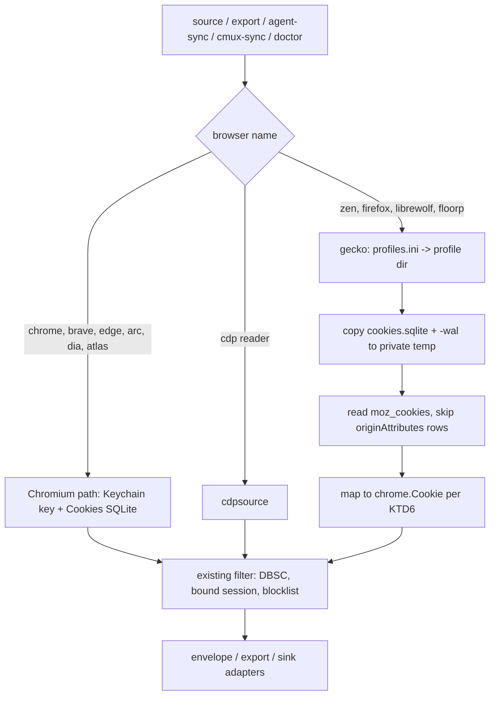

# Land open PRs, add a Zen/Firefox cookie source, and release v1.9.0 - Plan

## Goal Capsule

- Objective: a v1.9.0 release in which long-running sinks stop piling up blank tabs and Chrome bundle copies, agentcookie can read logins from Zen, Firefox, LibreWolf and Floorp, nothing it ships can close or misdirect a user's own browser tabs, and every outside contributor is credited.
- Means: fix and squash-merge #168, #157 and #156 on their own branches (maintainer edits are allowed on all three), close the #161-#167 series, rebuild its core idea as one small Gecko cookie source co-authored with its author, then tag v1.9.0 so the release workflow builds it (KTD1, KTD2, KTD4).
- Authority: Matt asked for every PR to be either merged with credit or denied, and for a release at the end. He settled the Gecko series and the #156 sweep change in this session. Clearing the merge bar (R1) means merge, with no further check-in.
- Execution profile:
  - Three contributor PRs already exist and stay separate. Merge order is #168, then #157, then #156, because #157 and #156 both edit the top of `CHANGELOG.md`.
  - The Gecko source ships as one new PR opened by Matt's account.
  - The release tag comes last.
- Stop conditions:
  - If a contributor PR needs a redesign rather than the fixes listed here, leave a review explaining why, don't merge it, and release whatever did merge.
  - If release CI fails, stop and report. Never publish by hand from a dirty or unpinned build (`docs/releasing.md`).
  - If Greptile drops below 5/5 on a final head, fix the finding before merging. Never merge past it.
- Finisher: the executing agent finishes everything, through the published GitHub release and the final report to Matt.

---

## Product Contract

### Summary

Merge the three leak fixes after closing the review gaps found in each. Close the seven-part Gecko series with thanks. Ship a small, read-only Zen/Firefox cookie source in its place, co-authored by the series author. Release all of it as v1.9.0.

### Problem Frame

Ten contributor PRs are open.

- #168 (@Kyzcreig) stops agentcookie's own Chrome launches from leaking an APFS clone of the Chrome app bundle into the temp folder each time a launch is killed. On a sink running for a while these pile up into the hundreds.
- #157 (@hayECOM) stops the cmux adapter adding a blank browser tab on every sink restart.
- #156 (@hayECOM) stops each live-CDP inject leaving an `about:blank` tab behind. A shared Chrome grew to thousands of tabs and several GB in a couple of days. It also adds a sweep that closes the stale tabs on every sink start.
- #161-#167 (@ffu3xu4tw) are a 27k-line stacked draft series adding Gecko browser support. It also brings a new protocol v3, live Chrome destinations, a companion extension, a storage codec and container routing. Its own text says a real-browser test failed, CI never ran, and it should not be merged.

None of the contributors' PRs has run the repo's CI, because GitHub holds workflows from first-time contributors until a maintainer approves them. Greptile is the only completed review.

Independent review found three defects the bots missed:
- #157 reuses any open cmux tab. cmux supports several browser profiles, and its `tree` output does not say which profile a tab uses, so cookies could land in a profile the default-profile `verify` never sees, while the push reports success.
- #156's sweep runs on every sink start. On Linux `live_cdp` is on by default and points at the agents' own Chrome. A Playwright or Puppeteer `newPage()` that sits idle for over a minute matches its closing rule exactly, so it can close a page an agent is about to use. Its last-page guard also has a narrow race.
- #168's test checks a hardcoded copy of chromedp's defaults, so a chromedp upgrade that adds a default would silently drop it.

The idea behind the Gecko series is sound. agentcookie only reads Chromium browsers today, and Firefox-family browsers store cookies unencrypted in `cookies.sqlite`, so a reader needs no Keychain. The series' size, protocol change and missing verification are the problem, not the goal.

### Requirements

Merge bar
- R1. A contributor PR merges only when all of these hold on its final head:
  - every repo CI workflow passes: `ci`, `lint`, `govulncheck` and `pr-title`
  - Greptile scores it 5/5 with no unresolved threads
  - every fix this plan lists for it is in
  - CHANGELOG and docs match the behavior
- R2. Contributor credit is kept. A PR author stays the commit author on the squash. CHANGELOG entries credit them with the existing `(#150, by @Dannyxlm)` convention. Code rebuilt from a closed PR carries a `Co-authored-by:` trailer for its author.

Leak fixes
- R3. agentcookie-launched Chrome on macOS no longer leaves `code_sign_clone` copies behind, and chromedp's own `--disable-features` defaults are still passed (#168).
- R4. A cmux push never sets cookies through a tab whose cookie store might differ from the one `verify` reads. When cmux has exactly one browser profile and a usable tab is open, it adds no tab (#157).
- R5. A live-CDP inject never creates a page target (#156).
- R6. Closing stale blank tabs never happens automatically. It runs only when a user runs it, and it never closes the browser's last page (#156).

Gecko cookie source
- R7. `browser.name` (config) and `--browser` accept `zen`, `firefox`, `librewolf` and `floorp`. Cookies are read from that browser's profile on macOS and Linux, and work in every command that already reads source cookies through the shared pipeline.
- R8. The reader never writes to the live profile and never touches the Keychain, and it works while the browser is running.
- R9. Only ordinary cookies are read. Container, private-browsing and partitioned cookies are skipped, because agentcookie's cookie model has no slot for them.
- R10. Read cookies have the same meaning as Chromium cookies do downstream: expiry, last access, SameSite, secure scheme and host-only versus domain.
- R11. A command that cannot serve a Gecko browser refuses it with a clear message. It never silently falls back to reading Chrome's cookie file.
- R12. `agentcookie doctor` reports a Gecko source as working or broken, without Keychain or decrypt checks.

Release
- R13. v1.9.0 is published through the tag-triggered `release` workflow. Its notes list each merged change with credit. Its assets are the signed, notarized darwin tarball and the pinned Linux tarballs.

### Key Decisions

- Close #161-#167 and rebuild a small Gecko cookie source now. (session-settled: user-directed — chosen over leaving the drafts open, or salvaging only the #161 registry refactor: the series is overbuilt and unverified, but Firefox-family support is worth having now.) Governs R7, R8, R9, R10, R11, R12, R2.
- #156's stale-tab sweep becomes a command a user runs by hand. (session-settled: user-approved — chosen over a sweep on every sink start: the leak fix removes the source of new stale tabs, so repeating the sweep adds risk to agents' pages and gains nothing.) Governs R6.

### Scope Boundaries

- Out: Gecko Local Storage, IndexedDB and session storage. The source ships cookies only, and storage packing is skipped for a Gecko profile.
- Out: Firefox containers mapped to separate destinations, the protocol v3 envelope, live Chrome destinations, a companion extension and the BiDi broker from the closed series.
- Out: Safari.
- Out: writing cookies into a Gecko browser. Gecko is a source only.
- Considered and not built: requiring the Gecko browser to be closed before reading, as the series did. Reading a private copy of `cookies.sqlite` plus its `-wal` is the established approach of browser_cookie3 and similar readers, and it never touches the live file. Evidence of torn or inconsistent reads from a running browser would change this.
- Considered and not built: a once-per-endpoint automatic sweep recorded in a state file. The manual command covers the users the old leak hit, and it needs no extra state.

#### Deferred to Follow-Up Work

- `export`, `agent-sync` and `cmux-sync` take `--browser` but still read `cfg.Chrome.DBPath`, so a Chromium `--browser` override only changes the Keychain item. This plan fixes that only for Gecko names (R11). The same gap for Chromium names is a separate issue.
- `docs/faq.md` is stale about Brave, Edge and Arc as well as Firefox. This plan corrects only the browser-support answer.

---

## Planning Contract

### Key Technical Decisions

- KTD1. **Fix on contributors' branches, then squash-merge.** All three heads allow maintainer edits, so fixes go on the contributor's branch as extra commits and the squash keeps them as author (R2). Fall back to cherry-picking onto a maintainer branch with a `Co-authored-by:` trailer only if a push to their branch is refused.
- KTD2. **Gecko is its own package and registry, not new entries in `browserRegistry`.** `internal/chrome/browser.go` models Chromium forks by their Safe Storage Keychain item, and `browser_registry_consistency_test.go` assumes every entry has a `Cookies` file. A separate `internal/gecko` package holds the Gecko table, profile resolution and reader, and returns `[]chrome.Cookie`. Config name validation and `SupportedBrowserNames()` accept the union, and the consistency test checks each table separately. This was chosen over the closed series' shared multi-family registry (#161), which touches every Chromium path to deliver nothing on its own.
- KTD3. **Branch at `readConfiguredCookies`, plus the Chromium-only steps in `source`.** `internal/cli/cookie_pipeline.go` `readConfiguredCookies` already branches for the CDP reader, and Gecko branches there the same way. Each command's Keychain step is skipped for a Gecko browser. `internal/cli/source.go` has four Chromium-only points, and each needs a Gecko branch:
  1. In `runSource`, the `chrome.LookupBrowser` call and the Keychain read.
  2. In `runSource`, the watcher's Local Storage and IndexedDB directories, which are left empty for Gecko.
  3. In `pushOnce`, the direct `readFilteredCookies` call, which routes through the Gecko reader.
  4. In `pushOnce`, the `chrome.LookupBrowser` plus `chromedirsync.Pack` storage block, which is skipped for Gecko. `LookupBrowser` rejects Gecko names, so leaving it in place fails every real push.
- KTD4. **Read a private copy.** This meets R8 without depending on the browser's lock behavior.
  1. Copy `cookies.sqlite` and its `cookies.sqlite-wal` into a fresh `0700` temp directory. When the live profile has no `-wal`, after a clean browser exit, create an empty one in the copy, because SQLite refuses to open a WAL-mode file read-only without one.
  2. Check both live files' size and mtime before and after the copy. If either changed, the browser wrote or checkpointed mid-copy, so retry, a small bounded number of times.
  3. Open the copy read-only so the WAL applies, read `moz_cookies`, and delete the copy.
  4. If the copy never settles, or the copy reads as malformed, fail the read with an error. Never return a partial cookie set, because a sink applying a partial set would lose logins.
- KTD5. **Profile resolution follows what the browser itself opens.** Read `profiles.ini` under the browser root:
  1. The `[Install…]` section's `Default=` path, which is the profile the installed browser really uses.
  2. Otherwise the `[Profile…]` marked `Default=1`.
  3. Otherwise the only profile.

  `browser.profile` may name a profile by its `Name=` or by its directory, relative or absolute. When `browser.profile` is unset, any ambiguity is an error that lists the candidates. That covers more than one candidate with no default, several `[Install…]` sections with different `Default=` paths (release, Developer Edition, Nightly), and more than one existing root with a `profiles.ini` (native plus snap or flatpak). Silently picking one could ship a stale profile's cookies.
- KTD6. **Mapping to `chrome.Cookie` is fixed in one place, keyed on the `moz_cookies` schema version (`PRAGMA user_version`)** (R10). The current schema (v17, confirmed on a local Firefox profile) differs from older ones, so the implementer confirms the exact version where each change landed against Mozilla's cookie storage schema history.
  - `host`, `name`, `value` (plaintext) and `path` map to `HostKey`, `Name`, `Value` and `Path`. `host` keeps its leading-dot convention, which matches Chrome's `host_key`.
  - `isSecure` and `isHttpOnly` map to `IsSecure` and `IsHTTPOnly`. Dropping either would send a Secure cookie over http, or expose an HttpOnly cookie to page JavaScript.
  - Expiry is epoch milliseconds in the current schema and epoch seconds in older ones. Normalize to seconds, then convert to Chrome microseconds since 1601: add 11644473600 seconds and multiply by 1e6. Last access is microseconds since 1970, so only the epoch offset is added.
  - `HasExpires` and `IsPersistent` are 1 when expiry is set. Cookies already expired at read time are dropped. Compare in normalized seconds.
  - SameSite on the current schema, which has no `rawSameSite` column: 0 (unset) maps to Chrome -1, 1 to Lax, 2 to Strict, and 256 to None. Older schemas with `rawSameSite`: `sameSite` 0/1/2 maps to None/Lax/Strict, and an unset `rawSameSite` maps to -1.
  - `schemeMap` bit 2 (https) maps to source scheme 2, http only to 1, anything else to 0. `SourcePort` is -1, Chrome's unspecified value, because Gecko stores no port. `Priority` defaults to 1, medium.
  - Rows with a non-empty `originAttributes` are skipped (R9). `TopFrameSiteKey` and `HasCrossSiteAncestor` stay empty.
- KTD7. **The #156 sweep becomes `agentcookie sink sweep-tabs`.** It reuses `livecdp.SweepStaleBlankTabs` against the configured `live_cdp` endpoint, with an `--endpoint` override and `--dry-run` that lists without closing. Its startup wiring in `runSink` and the pull loop is removed. Place it under whichever command group already owns `live_cdp`. The name may follow that group's convention.
- KTD8. **#157 reuses a tab only when cmux has exactly one browser profile.** Ask cmux for its browser profiles once per push. With exactly one, keep #157's reuse logic. With more than one, or when the profile list is unavailable, add the adapter's own tab in the default profile, which is the profile `verify` probes. This follows the old one-tab-per-process behavior instead of a tab per push. `cmux new-surface` has no `--profile` flag, so a tab added with it can inherit another profile. Create the fallback tab with `cmux browser open --profile <default profile>`, which takes an explicit profile and does not take focus by default.

### High-Level Technical Design

### Assumptions

- The Gecko browser roots are those in the closed #163 registry: macOS `~/Library/Application Support/{zen,Firefox,librewolf,Floorp}`, and Linux `~/.zen`, `~/.mozilla/firefox`, `~/.librewolf`, `~/.floorp`, plus their snap and flatpak roots. Verify against an installed Zen profile on this Mac if one exists.
- A cmux build without the browser-profile list is treated as "unknown", not "one", for KTD8.

---

## Implementation Units

### U1. Land #168: no leaked Chrome bundle copies

- **Goal:** merge #168 with a test that catches a chromedp default change (R3).
- **Requirements:** R1, R2, R3
- **Dependencies:** none
- **Files:** `internal/chromeflags/chromeflags.go`, `internal/chromeflags/chromeflags_test.go`, `CHANGELOG.md`
- **Approach:**
  1. Replace the hardcoded-list test with one that derives chromedp's real default `--disable-features`. Capture the arguments `chromedp.DefaultExecAllocatorOptions` produce by pointing the allocator at a tiny fake Chrome executable that records its argv and exits. Assert that every default feature appears in `ChromedpDisabledFeatures()`.
  2. Add a CHANGELOG entry crediting @Kyzcreig.
  3. Approve the first-time-contributor workflows, get CI green, then re-trigger Greptile.
- **Test scenarios:**
  - The fake-Chrome capture sees chromedp's real default `disable-features` list, and every entry is in `ChromedpDisabledFeatures()`.
  - The existing merge/dedupe table still passes.
- **Verification:** R1 holds on the final head. Squash-merge.

### U2. Land #157: cmux reuses a tab only where cookies reach `verify`

- **Goal:** merge #157 with the one-profile guard (R4, KTD8).
- **Requirements:** R1, R2, R4
- **Dependencies:** U1 merged (CHANGELOG ordering only)
- **Files:** `internal/sinkpush/adapter_cmux.go`, `internal/sinkpush/adapter_cmux_test.go`, `CHANGELOG.md`
- **Approach:**
  1. Rebase onto main. The only conflict is the CHANGELOG top.
  2. Before reuse, ask cmux for its browser profiles. Reuse only with exactly one profile. Otherwise add one adapter tab, explicitly in the default profile (KTD8), and cache it, as before.
  3. Keep the PR's dead-shell probe and stale-cache logic unchanged.
- **Test scenarios:**
  - With two cmux browser profiles and an open blank tab, the push adds its own tab and never calls `cookies.set` on the existing one.
  - With two profiles, the command that adds the fallback tab names the default profile explicitly.
  - With the profile list unavailable, the push adds one tab, and a second push reuses the cached tab without adding another.
  - With one profile, all of the PR's existing reuse tests still pass.
- **Verification:** `go test ./internal/sinkpush/...` passes, apart from the two `TestInstacartAdapter_IsInstalled_*` failures, which also fail on main because `instacart-pp-cli` is installed on this machine. R1 holds. Squash-merge.

### U3. Land #156: inject without a tab, sweep only on request

- **Goal:** merge #156's leak fix as-is and make its sweep a manual command (R5, R6, KTD7).
- **Requirements:** R1, R2, R5, R6
- **Dependencies:** U2 merged (CHANGELOG ordering only)
- **Files:** `internal/livecdp/sweep.go`, `internal/livecdp/sweep_test.go`, `internal/cli/sink.go`, `internal/cli/sink_pull.go`, `internal/cli/sink_sweep.go`, `internal/cli/sink_sweep_test.go`, `CHANGELOG.md`, `README.md`
- **Approach:**
  1. Rebase onto main. The only conflict is the CHANGELOG top.
  2. Remove the sweep's startup calls from `runSink` and the pull loop.
  3. Expose the sweep as a command under the group that owns `live_cdp` (KTD7), with `--endpoint` and `--dry-run`.
  4. In `closeStaleBlanks`, relist before every close once the page count is within the relist batch size of the floor, which closes the last-page race.
  5. Rewrite the CHANGELOG entry: injects no longer leave tabs, and users who saw a pile-up run the command once.
- **Patterns to follow:** existing sink subcommands in `internal/cli/sink*.go` and their tests.
- **Test scenarios:**
  - A sink start, both push and pull loop, makes no sweep calls. Invert the PR's `runSink` wiring test.
  - The command with `--dry-run` lists candidates and closes nothing.
  - The command closes stale blanks and keeps a real page, a fresh blank and the spared last blank.
  - Near the floor, another client closing pages between closes never leads the sweep to close the last page. Use a fake target list that drops pages mid-batch.
  - `TestAttachAndInject_LeavesNoTabs` stays as the opt-in live test. Run it with `AGENTCOOKIE_LIVE_CDP_TEST=1` if Chrome is available.
- **Verification:** `go test ./internal/livecdp/... ./internal/cli/...` passes. R1 holds. Squash-merge.

### U4. Close the Gecko series

- **Goal:** close #161-#167 with credit and a pointer to the replacement (R2).
- **Requirements:** R2
- **Dependencies:** U5's PR opened, so the closing note can link it
- **Files:** none
- **Approach:** post one short, kind comment on each PR and close it. The comment says:
  - Firefox-family support is wanted, and its core now ships as a small cookie source, linked, with @ffu3xu4tw as co-author.
  - The rest was too large to review or verify as one change: protocol v3, live destinations, storage codec, containers and companion.
  - Later pieces are welcome as an issue first, then small PRs that each pass CI.

  The comment on #161 carries the full note, and #162-#167 point to it.
- **Test expectation:** none -- no code.
- **Verification:** all seven PRs are closed with the comment, and none is merged.

### U5. Gecko cookie source

- **Goal:** read Zen, Firefox, LibreWolf and Floorp cookies through the existing pipeline (R7-R12, KTD2-KTD6).
- **Requirements:** R2, R7, R8, R9, R10, R11, R12
- **Dependencies:** none. Build it in parallel with U1-U3 and rebase before merging.
- **Files:**
  - create `internal/gecko/browser.go`, `internal/gecko/profiles.go`, `internal/gecko/read.go`
  - create tests `internal/gecko/profiles_test.go`, `internal/gecko/read_test.go`
  - modify `internal/config/config.go` and `internal/config/config_test.go`
  - modify `internal/cli/cookie_pipeline.go`, `internal/cli/source.go`, `internal/cli/export.go`, `internal/cli/agentsync.go`, `internal/cli/cmux_sync.go`, `internal/cli/doctor.go`
  - modify `internal/cli/browser_registry_consistency_test.go`
  - modify `README.md`, `docs/faq.md` and `CHANGELOG.md`
- **Approach:**
  1. In `internal/gecko`, add the browser table (KTD2), the `profiles.ini` resolver (KTD5), and the private-copy reader plus mapper (KTD4, KTD6).
  2. Config: accept Gecko names in `browser.name` and resolve a cookies path to the profile's `cookies.sqlite`. Leave Local Storage and IndexedDB paths empty.
  3. CLI: branch in `readConfiguredCookies` and at each `source.go` point KTD3 lists. Skip the Keychain step for Gecko in `source`, `export`, `agent-sync` and `cmux-sync`. Where `--browser` names a Gecko browser, resolve its own cookies path (R11).
  4. Watcher: `source --watch` watches `cookies.sqlite` and its `-wal`. The watcher already matches on the cookie file's basename.
  5. Doctor: add a Gecko branch in `checkSourceAdapter` covering profile resolved, `cookies.sqlite` present, and a smoke read with a count. Skip the Keychain and decrypt steps (R12).
  6. Docs: README gets a "Firefox-family browsers" note. The faq browser answer is corrected. The CHANGELOG entry credits the closed series, `(rebuilt from #161-#167, by @ffu3xu4tw)`.
  7. Every commit carries `Co-authored-by: ffu3xu4tw <231384398+ffu3xu4tw@users.noreply.github.com>`.
- **Patterns to follow:**
  - `internal/cdpsource/source.go` for mapping non-Chromium data into `chrome.Cookie`
  - `internal/cli/cookies_test.go` `makeSidecar` for building a fixture SQLite DB
  - `internal/config/config_test.go` browser-block cases
- **Execution note:** build the mapper test-first against a fixture `moz_cookies` table, because R10 mistakes are silent downstream.
- **Test scenarios:**
  - Use a v17-shaped fixture whose values are copied from a real current `moz_cookies` row, with millisecond expiry, plus one legacy-schema fixture with second expiry and `rawSameSite`.
  - On the v17 fixture, a domain cookie, a host-only cookie and an expired cookie map the first two with correct Chrome-epoch expiry and leading dots, and drop the expired one. The legacy fixture gives the same Chrome expiry for the same instant.
  - `isSecure` and `isHttpOnly` set on a row come through as `IsSecure` and `IsHTTPOnly`, and unset ones stay 0.
  - Rows with `originAttributes` `^userContextId=2`, `^privateBrowsingId=1` and `^partitionKey=…` are skipped.
  - v17 `sameSite` 0/1/2/256 maps to -1/1/2/0. On the legacy fixture, `sameSite` 0/1/2 maps to 0/1/2, and an unset `rawSameSite` maps to -1. `schemeMap` https and http map to 2 and 1. `SourcePort` is -1.
  - A committed row present only in `cookies.sqlite-wal` is read. The live files' bytes and mtimes are unchanged after the read, and the temp copy is gone.
  - A profile with no `cookies.sqlite-wal` reads successfully.
  - A live file that changes during every copy attempt makes the read fail with an error, and no cookies are returned.
  - `profiles.ini` with an `[Install…]` default picks that profile over a `[Profile]` marked `Default=1`. These cases error and list the candidates:
    - two profiles and no default
    - two `[Install…]` sections with different defaults
    - native and snap roots that both exist

    `browser.profile` works both by `Name=` and by directory, and it resolves each ambiguous case.
  - Config `browser: {name: zen}` resolves the Zen root on macOS and Linux test homes.
  - `export --browser firefox` reads the Firefox profile and never opens Chrome's `Cookies` file or the Keychain.
  - Doctor on a resolved Gecko profile reports OK with a cookie count. With a missing `cookies.sqlite` it reports a failure naming the path.
  - The registry consistency test passes for both tables. An unknown name lists Chromium and Gecko names in its error.
  - Integration: a real `pushOnce` (not `--dry-run`, which returns before the storage step) with a Gecko config posts to a fake sink. The posted envelope carries the Gecko cookies after the existing DBSC and blocklist filter, and no Local Storage or IndexedDB tarball.
- **Verification:**
  - All new and existing tests pass.
  - Manual smoke if Zen or Firefox is installed on this Mac: `agentcookie export --browser zen` against the real profile, while the browser is running, returns cookies for a site known to be logged in.
  - The PR passes R1's CI and Greptile bar, then squash-merges.

### U6. Release v1.9.0

- **Goal:** publish v1.9.0 with everything that merged (R13).
- **Requirements:** R2, R13
- **Dependencies:** U1, U2, U3 and U5 merged, or explicitly rejected under a stop condition. U4 done.
- **Files:** `CHANGELOG.md` (rename `[Unreleased]` to the v1.9.0 heading, if that is the repo's release convention)
- **Approach:** follow `docs/releasing.md` and the tag-triggered `release.yml`. Write notes from the CHANGELOG with each contributor credited. Confirm that the darwin asset is signed, notarized and pinned to the Linux digests.
- **Test expectation:** none -- release mechanics. Proof is in verification.
- **Verification:** the GitHub release v1.9.0 exists with all three tarballs, and `release` CI is green.

---

## Verification Contract

| Gate | Command or check | Applies to |
| --- | --- | --- |
| Build and vet | `go build ./... && go vet ./...` | U1, U2, U3, U5 |
| Unit tests | `go test ./...`, where only the known `TestInstacartAdapter_IsInstalled_*` local-environment failures are tolerated, and must also fail on main | U1, U2, U3, U5 |
| Lint | `golangci-lint run` per `.golangci.yml` (the `lint` workflow) | U1, U2, U3, U5 |
| Live CDP (opt-in) | `AGENTCOOKIE_LIVE_CDP_TEST=1 go test -tags livechrome ./internal/livecdp/...` when Chrome is present | U3 |
| Repo CI | `ci`, `lint`, `govulncheck`, `pr-title` green on the PR head, after approving first-time-contributor runs | U1, U2, U3, U5 |
| Review | Greptile 5/5 with no unresolved threads on the final head | U1, U2, U3, U5 |
| Release | `release` workflow green, and assets present and pinned | U6 |

---

## Definition of Done

- #168, #157 and #156 are merged with their authors credited, or left unmerged with a review saying why.
- #161-#167 are closed with the note, and the Gecko source PR is merged with @ffu3xu4tw as co-author.
- v1.9.0 is published with credited notes.
- No scratch worktrees, fake-Chrome helpers outside tests, or abandoned code are left in any merged diff. The `/tmp` review worktrees `pr156-rebase` and `pr157wt` are removed.
- The final report to Matt lists each PR's outcome, the release URL, and anything left undone.
