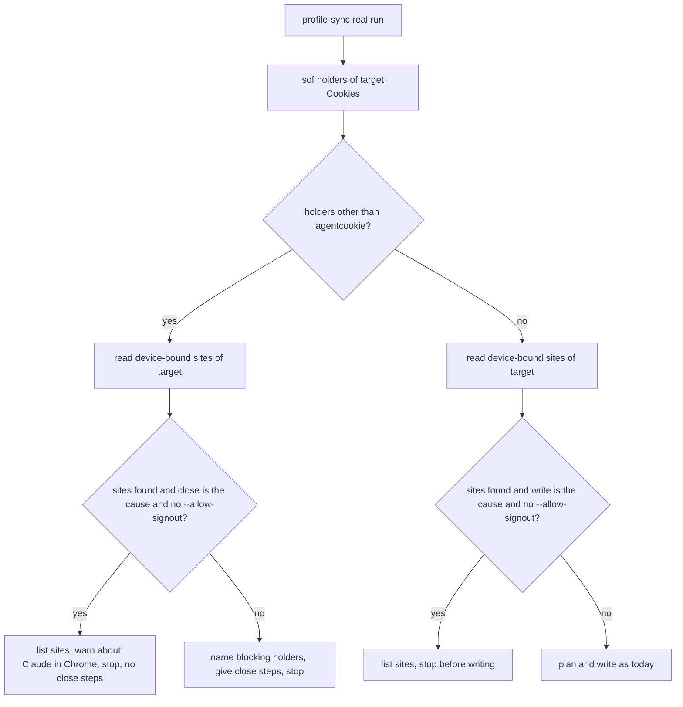

# profile-sync ignores its own daemons and warns before a sign-out - Plan

## Goal Capsule

- Objective: `agentcookie profile-sync` runs whenever the target profile is actually closed, and it never leads the owner into losing a site login, above all claude.ai and with it Claude in Chrome, without saying so first and getting a yes.
- Means: classify who holds the target's cookie store so agentcookie's own readers don't block a run (KTD1). Read the target's Chrome device-bound session store to name the sites a close will sign out (KTD2). Hold the close instructions behind a confirming flag (KTD3). How the flag is placed depends on what U1 finds.
- Authority: this plan's Requirements win on behavior. KTDs win on mechanism. Repo conventions (cobra commands, test seams as package vars, `internal/chrome` readers) win on style.
- Stop conditions: stop and report if U1 shows the sign-out comes from something other than unloading the profile or profile-sync's write (for example the keep-alive's windowless reload). Never run U1 or any manual check against the owner's Default (Esperlabs) or Profile 1 (main) profile; use a throwaway profile.
- Execution profile: one PR to mvanhorn/agentcookie. macOS behavior; Linux must still build and test.
- Who finishes: `ce-work` builds and verifies on the owner's Mac, opens the PR, and merges once CI passes (owner's repo).

---

## Product Contract

### Summary

Fix two profile-sync failures from 2026-11-22. It refused to run against a closed profile because agentcookie's own `source --watch` and `cmux-sync --watch` daemons held the cookie file open. And its "close the profile" instructions led to the Esperlabs profile losing its claude.ai login, which disconnected Claude in Chrome. After this change, agentcookie's own readers don't block a run, and profile-sync names the sites a close will sign out and asks for a confirming flag before telling the owner to close anything.

### Problem Frame

The owner keeps one Chrome profile per Claude account so Claude in Chrome works for both, and copies site logins between them with `profile-sync`. A real run needs the target profile closed, and it checks that by asking `lsof` whether any process has the target's `Cookies` file open. agentcookie's own long-running daemons read every discovered profile's `Cookies` file and keep it open, so the check refused even after Chrome let go. The owner had to stop two LaunchAgents by hand to get a run through.

The worse failure came before that. Following the refusal's advice (pause the keep-alive, close the profile), the Esperlabs profile was unloaded. When it came back, the claude.ai session created at 01:18 UTC was gone from its cookie store (it was present in the 01:31 chrome-backup snapshot and absent after the run), only an older Nov 15 session remained, claude.ai showed its sign-in page, and Claude in Chrome stayed disconnected until the owner signed in again. claude.ai uses Chrome's Device Bound Session Credentials in that profile: `.claude.ai` and `claude.ai` appear in the profile's `Device Bound Sessions` store, and the lost `sessionKey` row carried `has_cross_site_ancestor=1`. profile-sync never copies claude.ai cookies (`profileSyncDefaultExcludes`), so the write was not the obvious cause. Whether unloading alone ends the bound session, or the reload after profile-sync's write does, is not yet proven.

### Requirements

Running when closed
- R1. A real run proceeds when the only processes holding the target's cookie store are agentcookie processes (any `agentcookie` binary, including this run). Any other holder still blocks the run.
- R2. When the run is blocked, the message names each blocking process by command name and PID, so the owner can see whether it is Chrome or something else.

No sign-out without a yes
- R3. Before profile-sync tells the owner to close a profile, and before it writes to one, it reads the sites with device-bound sessions in that profile. When there are any, it lists them and says those logins will need signing in again. When claude.ai is among them, it says Claude in Chrome for that profile will disconnect until the owner signs in again.
- R4. A run that would cause that sign-out does not give close instructions or write until the owner reruns with a confirming flag. Where the flag is checked depends on U1's finding (KTD3).
- R5. A dry run always reports the device-bound sites it found and never needs the flag.
- R6. A profile with no device-bound sessions behaves exactly as today: no extra output, no flag needed.

Docs
- R7. `profile-sync --help`, the README's two-profile section, and the changelog state that closing a profile can sign it out of device-bound sites, and name the flag.

### Acceptance Examples

- AE1. Covers R1. Given the target profile is closed in Chrome and `agentcookie source --watch` and `cmux-sync --watch` hold its `Cookies` file open, when `profile-sync --from "Profile 1" --to "Profile 2"` runs, then it writes and reports the count. No LaunchAgent is touched.
- AE2. Covers R1, R2. Given a Chrome helper process holds the target's `Cookies` file, when profile-sync runs, then it refuses and the message names `Google Chrome Helper` and its PID.
- AE3. Covers R3, R4. Given the target is open and its device-bound store lists claude.ai and google.com, when profile-sync runs without the flag, then it lists both sites, says Claude in Chrome will disconnect, gives no close instructions, and exits non-zero.
- AE4. Covers R5. Given the same profile, when profile-sync runs with `--dry-run`, then it prints the plan and the device-bound site list and exits zero.

### Scope Boundaries

- Not changing what gets copied, the ownership model, or `profileSyncDefaultExcludes`.
- Not changing the keep-alive, cookie syncing to other machines, or `chrome-backup`.
- Not restoring a lost device-bound session. The binding key belongs to Chrome, and restoring the old cookies does not bring the session back.
- Considered and not built: copying cookies into a live profile so it never has to close. That needs a debugging connection into the owner's real Chrome, which agentcookie deliberately avoids. Revisit if Chrome offers a supported way to add cookies to a running profile.
- Considered and not built: keying the holder check on Chrome's PID through `chromectl.ProfileLoaded` instead of `lsof` on the file. Chrome opens `Cookies` from its network-service helper, not the main browser process, and any unknown writer should still block (R1). Revisit if helper detection becomes reliable.
- Considered and not built: a separate per-site allowlist for the flag. One flag covering the listed sites is enough for one owner. Revisit if a second user needs finer control.

### Deferred to Follow-Up Work

- A `doctor` warning when no Chrome profile's Claude in Chrome extension is signed into the account the current Claude Code session uses. Offered in the same session and kept out of this plan's scope.

---

## Planning Contract

### Key Technical Decisions

- KTD1. Keep `lsof` on the target's `Cookies` file, but read holders with their command names and drop agentcookie's own. A holder is agentcookie's own when its PID is this process or its command is `agentcookie`. Everything else blocks. `profileSyncFileInUse` becomes a seam that returns holders instead of a bool, so tests feed it canned holder lists. The daemons only read, with SQLite's own locking, so a write while they hold the file is as safe as Chrome's own writes against them.
- KTD2. Read device-bound sites from the target profile's `Device Bound Sessions` SQLite file (`dbsc_session_tbl`, one row per session) in a new `internal/chrome` reader. Open it read-only and immutable, the way the existing cookie readers open a store Chrome may hold, and return distinct registrable sites. The exact key format is parsed at implementation time (see Deferred to Implementation). Only a missing file means "no sites" (R6). A file that exists but can't be read means "status unknown": profile-sync prints a one-line note and treats it like a found site list for the KTD3 flag check, without naming sites, so a read error never silently passes the gate. This is the authoritative signal. The `dbsc.go` short-TTL heuristic is not used, because it guesses from cookies while this store lists the sessions directly.
- KTD3. Add one boolean flag, `--allow-signout`, that acknowledges the listed sign-outs. Where it is checked depends on U1:
  - If unloading the profile alone ends the bound session, the check sits on the "profile is open" path. Without the flag, profile-sync lists the sites and stops without close instructions. With it, profile-sync gives the close instructions as today. A run against an already-closed profile can't undo the sign-out and doesn't ask.
  - If profile-sync's write (or the reload after it) ends the session while a plain close/reopen does not, the check sits right before the write instead, and the close instructions stay as they are.
  - If both happen, check in both places.

### High-Level Technical Design

Decision flow for a real run after this change (directional; the U1 outcome moves the flag check, per KTD3):

### Deferred to Implementation

- The `dbsc_session_tbl.key` format and how to turn it into a site name (it may be a site URL plus a session id, or may need the `proto` blob).
- Whether a target that is open but held only by agentcookie can still have stale WAL rows. Today's closed-target read is WAL-aware; keep it.

---

## Implementation Units

### U1. Find out what ends the device-bound session

- Goal: settle KTD3 by finding which step ends a claude.ai device-bound session: unloading the profile, or profile-sync's write and the reload after it.
- Requirements: R3, R4
- Dependencies: none
- Files: none committed beyond a short findings note in the PR description.
- Approach:
  1. Create a throwaway Chrome profile and sign it into claude.ai with a disposable or the owner's secondary login, so `Device Bound Sessions` lists claude.ai. Ask the owner only for that sign-in.
  2. Close and reopen that profile (pause the keep-alive for it first). Record whether the claude.ai `sessionKey` row and the device-bound entry survive.
  3. If they survive, close it again, run profile-sync into it, reopen, and record the same.
  4. Pick KTD3's branch from the result.
- Execution note: this is a runtime probe, not unit coverage. Never use Default or Profile 1.
- Test expectation: none -- the finding is recorded and drives U4.
- Verification: the PR description states which step ends the session, with before/after `sessionKey` creation times.

### U2. Ignore agentcookie's own holders

- Goal: profile-sync's open check counts only non-agentcookie holders and names them.
- Requirements: R1, R2
- Dependencies: none
- Files: `internal/cli/profile_sync.go`, `internal/cli/profile_sync_test.go`
- Approach:
  1. Change the seam to list holders (PID and command) via `lsof` field output.
  2. Filter per KTD1.
  3. Use the filtered list in both the first check and the re-check right before the write.
  4. Put each blocking holder's command and PID in the refusal text.
- Patterns to follow: the existing `profileSyncFileInUse` seam and `chromectl/profileload.go`'s `lsof -F` parsing.
- Test scenarios:
  - Holders are only `agentcookie` PIDs: treated as closed, the run proceeds.
  - Holders include this process's own PID: treated as closed.
  - One `Google Chrome Helper` holder plus an `agentcookie` holder: refuses, the message names `Google Chrome Helper` and its PID and not agentcookie.
  - `lsof` exits 1 with no output: treated as closed, as today.
  - `lsof` fails some other way: returns the error, as today.
  - The re-check before the write sees a new non-agentcookie holder: nothing is written.
- Verification: AE1 and AE2 pass with the seam stubbed. On the owner's Mac, a run against a closed throwaway profile succeeds with both agentcookie daemons running.

### U3. Read a profile's device-bound sites

- Goal: a reader that returns the sites with device-bound sessions in a given profile directory.
- Requirements: R3, R5, R6
- Dependencies: none
- Files: `internal/chrome/boundsessions_store.go` (new), `internal/chrome/boundsessions_store_test.go` (new)
- Approach: open `<profile>/Device Bound Sessions` read-only and immutable, read `dbsc_session_tbl`, map each row to its site, then dedupe and sort. A missing file returns an empty list and no error. A file that exists but can't be read returns an error, which the caller treats as status unknown (KTD2).
- Patterns to follow: the read-only open in `internal/chrome/read.go`, and `hostMatchesSuffix` in `boundsession.go` for site matching.
- Test scenarios:
  - A fixture store with rows for `claude.ai`, `.claude.ai`, and `accounts.google.com`: returns `claude.ai` and `google.com` once each.
  - The profile has no `Device Bound Sessions` file: returns an empty list and no error.
  - The file exists but has no `dbsc_session_tbl`: returns an error (status unknown), not an empty list.
  - The store is held open by another connection: still reads (immutable open).
- Verification: tests pass on macOS and Linux, and against a copy of the owner's real store it reports claude.ai and google.com.

### U4. Gate on sign-out and say so

- Goal: profile-sync warns about device-bound sign-outs and needs `--allow-signout` where U1 says the sign-out happens.
- Requirements: R3, R4, R5, R6, R7
- Dependencies: U1, U2, U3
- Files: `internal/cli/profile_sync.go`, `internal/cli/profile_sync_test.go`, `README.md`, `CHANGELOG.md`
- Approach:
  1. Add `--allow-signout` (KTD3).
  2. Read the target's sites through a seam that wraps U3.
  3. Place the check per U1's branch.
  4. Mention Claude in Chrome whenever claude.ai is in the list.
  5. Dry run prints the list and never needs the flag.
  6. Update the help text, README's two-profile section, and the changelog under the repo's existing format.
- Test scenarios:
  - Open target, sites `[claude.ai, google.com]`, no flag (close-is-cause branch): exits non-zero, lists both sites, mentions Claude in Chrome, no close instructions.
  - Same with `--allow-signout`: gives today's close instructions and names the blocking holders.
  - Open target, no sites: today's message, no flag needed.
  - `--dry-run` with sites: prints the plan and the site list, exits zero.
  - Write-is-cause branch: closed target with sites and no flag stops before writing. With the flag it writes.
  - Sites list only google.com: warns about google.com and does not mention Claude in Chrome.
  - The site reader returns an error (store present but unreadable), no flag: prints the status-unknown note and is gated exactly as if sites were found. With the flag it proceeds.
- Verification: AE3 and AE4 pass. On the owner's Mac, a dry run against the Esperlabs profile lists claude.ai and google.com without closing anything.

---

## Verification Contract

- `go test ./...` and `go vet ./...` pass on macOS. The repo's Linux CI job passes (`internal/chrome` must build there).
- `golangci-lint run` passes with the repo's `.golangci.yml`.
- Manual checks only on a throwaway profile: AE1 with both agentcookie daemons running, and U1's probe. Read-only dry runs against Default and Profile 1 are fine.
- `agentcookie doctor` output is unchanged.

## Definition of Done

- U1's finding is recorded in the PR description and KTD3's branch is applied.
- R1 through R7 hold, AE1 through AE4 pass, and every unit's test scenarios are written.
- Help, README, and changelog updated.
- PR merged to main with CI green. The installed `agentcookie` binary on the owner's Mac is rebuilt from main, so the LaunchAgents and CLI match.
